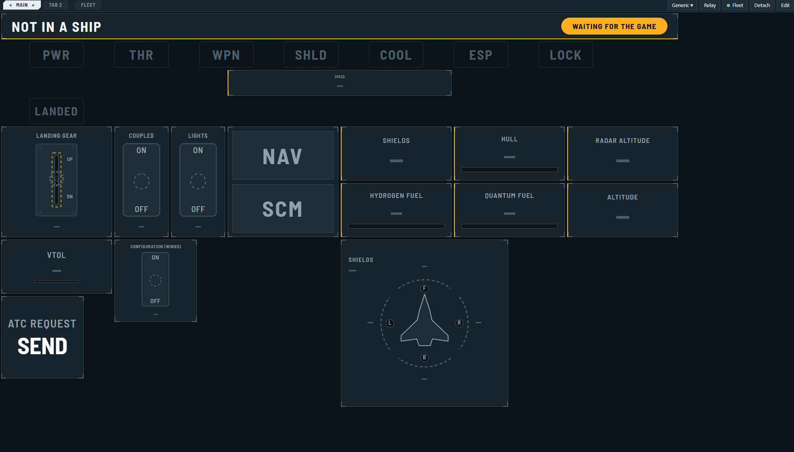
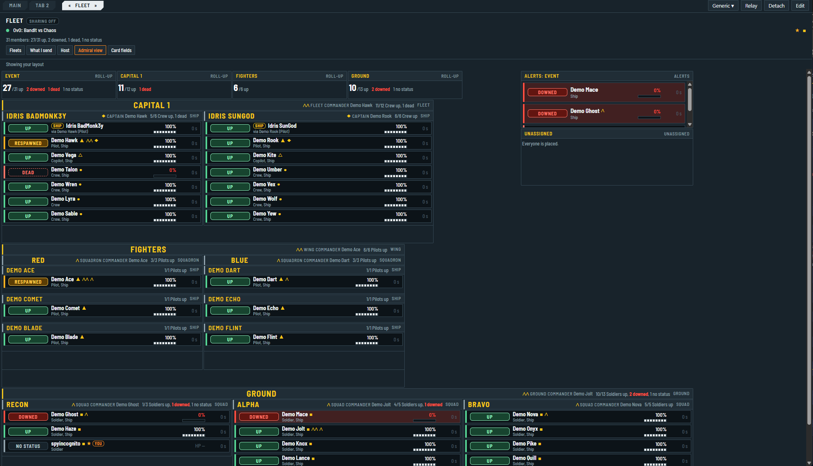

# Hardpoint

Your ship's status on your own screens, and your fleet's status beside it, for Star Citizen on
Windows.

## Contents

The user guide (wiki):

- [Home](docs/wiki/Home.md): what Hardpoint is and where to start.
- [Install and set up](docs/wiki/Install-and-setup.md): download, verify, first run, the
  settings folder and firewall prompts.
- [Dashboards](docs/wiki/Dashboards.md): tabs, widgets, edit mode, themes, cell size, ship
  dashboards, detached tabs, import and export.
- [Fleet with CIC](docs/wiki/Fleet-CIC.md): join an org's event with a connection code, what you
  share, the fleet panel and the Fleet tab.
- [Peer to peer](docs/wiki/Fleet-P2P.md): host a fleet from your PC, or join a friend's.
- [Companion](docs/wiki/Companion.md): a paired laptop or tablet as the screen.
- [Stream Deck](docs/wiki/Stream-Deck.md): the Hardpoint Fleet Status plugin.
- [Troubleshooting](docs/wiki/Troubleshooting.md) and [FAQ](docs/wiki/FAQ.md).
- [Coming soon](docs/wiki/Coming-soon.md): what we are working on next.
- [For AI agents](docs/wiki/For-AI-agents.md): a summary and the key facts, for tools that read
  the docs.

This README:

- [What Hardpoint does](#what-hardpoint-does)
- [Install](#install)
- [Download and verify a release](#download-and-verify-a-release)
- [Tech stack and layout](#tech-stack-and-layout)
- [Build from source](#build-from-source)
- [For AI installers](#for-ai-installers)
- [Licence and disclaimer](#licence-and-disclaimer)

## What Hardpoint does

Star Citizen serves a local telemetry API on your game PC. Hardpoint reads it and turns it into
dashboards you lay out yourself: shields, hull, fuel, power, weapons, lamps and toggles, on your
main screen, on a second display, or on a laptop or tablet beside you. Each ship can have its own
dashboard, and Hardpoint switches to it when you board.



Flying with others, Hardpoint is your fleet client. Join an org's event on a CIC
(Combat Information Center) server with a connection code, or host a small
peer-to-peer fleet from your own PC with no server at all. You see each member's status card as
your role allows, laid out by fleet, wing and squad, with roll-ups and alerts for who is down.



Why it matters:

- **You choose what you share.** Your card carries only the fields you turn on, and a field you
  leave off never leaves your PC. Your aUEC balance, keybinds and sequences are never put on a
  card.
- **API only.** Everything Hardpoint shows comes from the game's telemetry API, and every button
  goes through that same API. It presses no keys and changes no game files.
- **One program.** A single `hardpoint.exe`, no installer, settings in one folder you can back up.

How it works: Hardpoint runs on the game PC, talks to the game on `127.0.0.1`, and draws its
dashboards in native windows. Fleet connections and the companion link use TLS, with keys that
each side pins. An optional Stream Deck plugin shows read-only fleet status keys.

## Install

Hardpoint is a Windows exe (`hardpoint.exe`) that runs a Rust application. There is no installer:
download it, verify it, and run it. Full steps: [Install and set up](docs/wiki/Install-and-setup.md).

You need a Windows PC that runs Star Citizen; the game serves its telemetry API on
`127.0.0.1:2942`. Turn it on first:

- **Game 4.x (LIVE):** `setx GRPC_CLIENT_SERVER_ENABLED true`, then fully quit and restart the RSI
  Launcher (the game takes its environment from it), then the game. On 4.x the API is display only; action buttons need game 5.0.
- **Game 5.0 (PTU):** add `server.game.telemetry.enabled=1` to `user.cfg` in the game folder
  (create the file if it does not exist).

Full steps: [Turn on the game's telemetry API](docs/wiki/Install-and-setup.md#turn-on-the-games-telemetry-api).

**Heads-up: the exe is not code-signed.** Windows SmartScreen may show "Windows protected your PC"
the first time. Choose **More info**, check that the name is `hardpoint.exe`, then **Run anyway**.
Because there is no signature to vouch for the file, check its hash first (below): it is how you
know the exe you run is the one the release built.

## Download and verify a release

Releases are on the repository's
[Releases page](https://github.com/SpyIncognito/cic-hardpoint/releases). A version tag (`v*`)
builds each release on a GitHub-hosted Windows runner (`.github/workflows/release.yml`), with no
secrets and no code signing. Each release holds:

| File | What |
|---|---|
| `hardpoint.exe` | The app |
| `games.spyincognito.hardpoint.fleet.streamDeckPlugin` | The optional Stream Deck plugin |
| `SHA256SUMS` | The SHA-256 hash of both files |

To verify:

1. Download `hardpoint.exe` and `SHA256SUMS` from the same release.
2. In PowerShell, in the download folder:

   ```powershell
   Get-FileHash .\hardpoint.exe -Algorithm SHA256
   ```

3. Compare the hash with the `hardpoint.exe` line in `SHA256SUMS` (letter case does not matter).
   If they differ, do not run the file.
4. Optional: the workflow attests build provenance for both files. With the GitHub CLI:

   ```sh
   gh attestation verify hardpoint.exe --repo SpyIncognito/cic-hardpoint
   ```

   This shows the file was built by the repository's release workflow.

To trust nothing but the source, [build it yourself](#build-from-source): a source build lets you
review the code and run your own exe.

## Tech stack and layout

- **Rust** workspace, no unsafe code (`unsafe_code = "forbid"`). gRPC client for the game's
  telemetry API; HTTP and WebSocket on `127.0.0.1` for the dashboard pages and the local bus.
- **Native Windows** app: the dashboard in a native window, detached tabs, bezel buttons and a
  tray icon. Elsewhere it runs headless, for testing.
- **Fleet:** the `fleet-proto` wire protocol over TLS with ed25519 identity keys, shared with the
  CIC relay. **Companion:** TLS with SPAKE2 pairing on an 8-digit code.
- **Stream Deck plugin:** TypeScript, bundled with esbuild.

| Path | What |
|---|---|
| `crates/` | The Rust crates ([index](crates/README.md)) |
| `crates/fleet-proto` | The fleet wire protocol shared with the CIC relay: hello, identity challenge, invite, join, card schema, consent, subscriptions, roll-ups, roles and event structure. Tagged `fleet-proto/v<version>`; the relay pins a tag |
| `crates/sc-game` | The game's telemetry API: gRPC client, link with reconnect, replay and scrub |
| `crates/sc-core` | State model, values, catalog, engine and sequences |
| `crates/sc-service` | The local bus, the portal and dashboard pages over HTTP and WebSocket, and the fleet client (`hardpoint-service` binary) |
| `crates/sc-app` | The Windows desktop app (`hardpoint` binary, `hardpoint.exe` on Windows) |
| `pages/` | The dashboard and portal pages and their vendored libraries, embedded at build time |
| `schema/` | The telemetry schema, the single source for every client |
| `streamdeck/` | Hardpoint Fleet Status, a read-only Stream Deck plugin for fleet status keys ([README](streamdeck/README.md)) |
| `tools/` | Release build and identity check scripts, and `fleet-sim` (demo fleet members for testing a CIC relay; not shipped) ([README](tools/README.md)) |
| `Dockerfile` | The `fleet-sim` container image (Hardpoint itself ships as a Windows exe, not an image) |
| `PROTOCOL.md` | The bus, portal, dashboard, fleet and relay protocols, with the changelog |
| `docs/wiki/` | The user guide |
| `docs/screenshots/` | Screenshots for the READMEs and the guide, taken on made-up telemetry and demo fleets |

### Settings

Settings live in `%APPDATA%\Hardpoint` on Windows (`$XDG_CONFIG_HOME/hardpoint` on Linux). On the
first start, the folder earlier builds used (`sc-key-emulator`) is copied there once and left as a
backup. The bus file stays at `%APPDATA%\sc-key-emulator\bus.json`, where the Stream Deck plugin
looks for it. The files are listed in
[Install and set up](docs/wiki/Install-and-setup.md#settings-folder).

## Build from source

```sh
cargo build
cargo test
cargo clippy --all-targets -- -D warnings
cargo fmt --check
cargo deny check
cargo xwin build --release --target x86_64-pc-windows-msvc -p sc-app
```

The Windows release exe is `target/x86_64-pc-windows-msvc/release/hardpoint.exe`. For a release to
hand out, build it with `tools/build-release.sh`: the same build, with the build machine's paths
remapped so they do not end up in the exe; it prints the exe's size and SHA-256.
`tools/check-identity.sh` checks the files and history for personal or internal details before a
push.

### Contract and dashboard UI tests

They run against the built binary, over the wire only:

```sh
cargo build
cargo build -p sc-service --examples   # the test fleet relay the dashboard UI tests join
cd crates/sc-service/contract && npm ci
node --test contract.test.mjs
SC_PLAYWRIGHT=<dir with node_modules/playwright> node --test dash-ui.test.mjs
```

## For AI installers

A scriptable path. Facts for parsing are in [For AI agents](docs/wiki/For-AI-agents.md).

1. **Get the exe.** Either download `hardpoint.exe` and `SHA256SUMS` from the latest release at
   `https://github.com/SpyIncognito/cic-hardpoint/releases`, or build it:
   `cargo xwin build --release --target x86_64-pc-windows-msvc -p sc-app` (output
   `target/x86_64-pc-windows-msvc/release/hardpoint.exe`).
2. **Verify.** `(Get-FileHash .\hardpoint.exe -Algorithm SHA256).Hash` must equal the
   `hardpoint.exe` line in `SHA256SUMS`, case-insensitively. Optionally
   `gh attestation verify hardpoint.exe --repo SpyIncognito/cic-hardpoint`. Stop on a mismatch.
3. **Place and run.** Copy it to a folder of the user's choice and start it. Flags:
   `--no-splash`. The exe is unsigned, so the first start may need the user to pass SmartScreen.
4. **Config.** None is required. Settings are created in `%APPDATA%\Hardpoint`;
   `app-settings.json` takes `splash`, `relay` and `time` ([sc-app](crates/sc-app/README.md)).
5. **Ports.** Game telemetry `127.0.0.1:2942` (outgoing). Peer-to-peer hosting listens on TCP
   47522 and a companion on TCP 47521; allow those on private networks only, and only when the
   user turns those features on. Joining a CIC event makes outgoing connections only.
6. **Health check.** The running service writes the bus file
   `%APPDATA%\sc-key-emulator\bus.json` (`{ port, token, pid, version }`); the dashboard's status
   strip shows "Telemetry live" once the game answers.
7. **Headless service** (testing): `hardpoint-service [--port N] [--game HOST:PORT | --replay FILE.jsonl]`;
   environment `SC_MIP_PORT` (pages port, default 47520), `SC_GAME_ADDRESS`,
   `SC_CONTROL_BUS_FILE`.

## Licence and disclaimer

Copyright 2026 Spy Incognito Games. Licensed under the Apache License, Version 2.0; see
[`LICENSE`](LICENSE). Third-party parts keep their own licences, listed in [`NOTICE`](NOTICE).

Hardpoint is provided "as is", without warranties or conditions of any kind, and the authors
accept no liability for any damage arising from its use (Apache 2.0, sections 7 and 8). You
install and run it at your own risk. As with any public repository, review the code and verify
the release before you run it.
