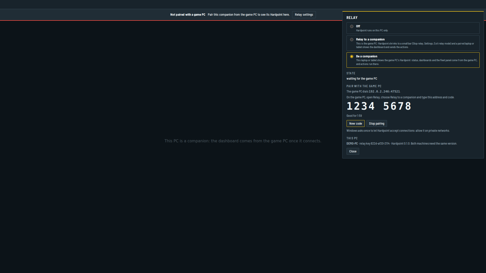

# sc-app

Hardpoint, the desktop app (the name is set in `src/brand.rs` as `APP_NAME` and `DISPLAY_NAME`; the exe is `hardpoint.exe`): the control service in-process, the dashboard in a native window, detached tabs on their displays, bezel buttons and a tray icon. Windows only for the windows; elsewhere it runs headless for testing. The app is API only: it presses no keys (the Stream Deck plugin keeps its own keybinds).

## Command line

See `hardpoint --help`. `--no-splash` skips the launch splash.

## App settings file

`app-settings.json` in the settings folder (the same folder as `dashboards.json`). Every key is optional; a missing file, a file that is not a JSON object or a key with the wrong type falls back to the default and is logged. Unknown keys are ignored. The Settings window will edit this file once it is built.

| Key | Type | Default | Effect |
|---|---|---|---|
| `splash` | boolean | `true` | `false`: no splash at launch |
| `relay` | object | `{ "mode": "off" }` | Relay mode (PROTOCOL.md section 5). `mode` is `off`, `relay` (this game PC relays its pages to the paired companion and starts straight into the relay bar: no splash, no dashboard webview) or `companion` (this machine shows the game PC's pages and listens for it); `port` is where a companion listens (default 47521). Set in the dashboard's Relay panel; the service writes this key and keeps the others |
| `time` | object | `{ "zone": "auto", "clock": "24h" }` | How the dashboard shows times: `zone` is `auto` (this computer's zone) or an IANA zone name from tzdata's `zone.tab` (or `UTC`), `clock` is `24h` or `12h`. Set in the dashboard's edit pane, under Time; the service writes this key and keeps the others. A bad field falls back to its default |

```json
{ "splash": false, "time": { "zone": "America/Denver", "clock": "12h" } }
```

## Relay bar



In relay mode the game PC shows only a small bar: its title bar and its own line show the link's status ("relaying to laptop", "connecting to laptop (retry in 4 s)", "not paired at <address>"), beside three buttons: **Stop relay** (or **Connect** when not linked), **Settings** and **Exit relay mode**. The bar is drawn on the CPU (`src/bar.rs`, Barlow from `assets/font`) and shown with softbuffer: no webview, no unsafe code of ours, and a repaint only when the status, the pointer's hover or press, or the display scale changes, or when Windows asks. The detached tabs close. The same actions are in the tray menu (Relay: stop relay or connect, Relay settings, Exit relay mode) and on keys while the bar has focus: D stops or connects, S opens the full window at its Relay panel (closing it drops the webview and leaves the bar), X or the close box exits relay mode and returns to the full window and the detached tabs. Stop relay from either side breaks the link: the companion can also unpair or leave.

## Splash

At launch on Windows the app shows a borderless 480 x 300 window, centred on the main display, with the Orbit Reticle icon and the working name. It opens while the service, the dashboard window and the tray start, and does not hold them up. It closes 2 s after it opened or when the dashboard page has loaded, whichever is later, and after 6 s at most; the dashboard window is then shown. Not shown with `--no-splash`, with `"splash": false`, or in headless runs.

## Artwork

`assets/orbit-reticle.svg` (colour) and `assets/orbit-reticle-mono.svg` (white, for the tray) are the Orbit Reticle icon. The PNGs beside them are those SVGs rasterised with Chromium: `icon-32.png` (title bar), `icon-256.png` (taskbar and Alt+Tab) and `tray-32.png` (tray). `hardpoint.ico` holds the colour icon at 16, 24, 32, 48, 64 and 256 px (the PNGs, rasterised the same way) and is the exe's Explorer icon, embedded by `build.rs` with the version information. Re-render them when the SVGs change. `assets/splash.html` is the splash page; the icon and the name are put in at run time.
