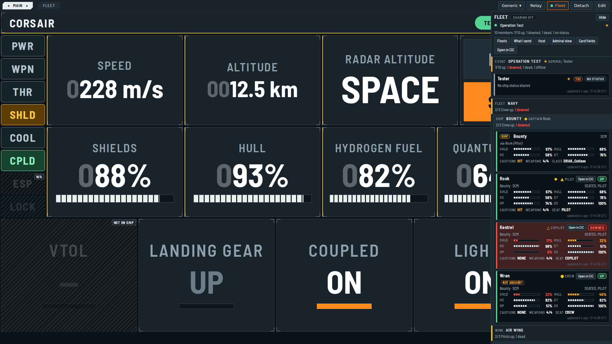
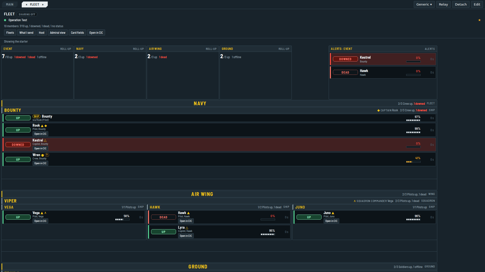
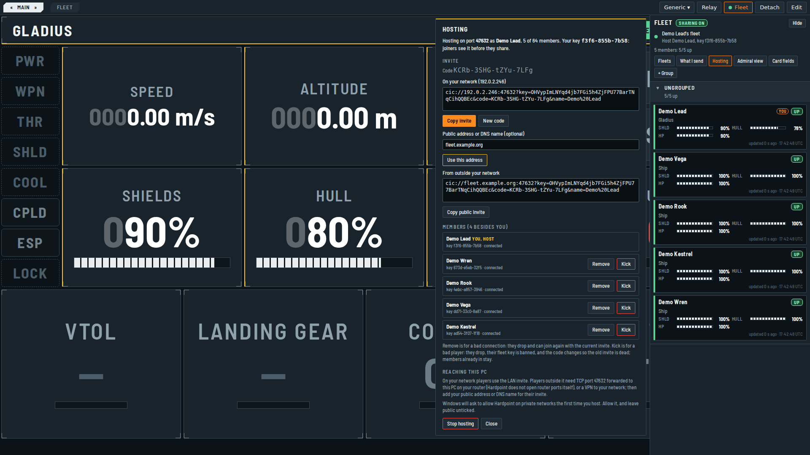

# sc-service

The Hardpoint service: one control core ([`sc-core`](../sc-core/README.md)) for every device. It
serves the core to other processes over the local bus (for Stream Deck plugins), serves the portal
and dashboard pages on `127.0.0.1`, and is the fleet client behind the dashboard's fleet panel.
The desktop app ([`sc-app`](../sc-app/README.md)) runs it in-process; the `hardpoint-service`
binary runs it on its own, without windows. The wire contract for the bus, portal and dashboard is
[`PROTOCOL.md`](../../PROTOCOL.md).

## Modules

| Module | What |
|---|---|
| `service` | `Service`: starts the core on the game, the bus and the pages, and stops them |
| `bus` | The local bus: a WebSocket on `127.0.0.1`, bus protocol version 1, for surfaces in other processes |
| `bus_fleet` | The bus's read-only `fleet.status` capability: roll-ups, who is down and member states for the Hardpoint Fleet Status Stream Deck plugin |
| `busfile` | The bus file (`{ port, token, pid, version }`) that tells clients where the running service is |
| `token` | The per-launch secrets (32 random bytes), compared in constant time |
| `pages` | The HTTP side: the portal (`/`, `/portal`) and dashboard (`/dash`) pages with the per-launch token put in, the vendored libraries (`/vendor/...`) and the portal WebSocket. The pages come from [`pages/`](../../pages/README.md), embedded at build time |
| `portal` | The pages' WebSocket session (every page message goes through one place), the ship status model and the catalog |
| `dashboard` | Dashboards: tabs of widgets on a 24-column grid, kept in `dashboards.json` (a generic dashboard and one per ship), validation of imported dashboards, the values model widgets bind to, and themes (`themes.json`) |
| `ship` | The ship the player is in: which functions its stream reports (unsupported controls are greyed) and when to switch to that ship's dashboard |
| `fleet` | The fleet client and the fleet panel (below) |
| `paths` | Where the files live: the settings folder, the one-time copy of an older settings folder, and the bus file |
| `json` | JSON written and read as the earlier TypeScript service did (number forms and key order) |

## Fleet client

A player joins a fleet from the fleet panel on the dashboard. The protocol types are in
[`fleet-proto`](../fleet-proto/README.md); the fleet server is the CIC relay, a separate project.

- **Identity.** On first use the service makes a fleet identity, an ed25519 key pair, kept in the
  settings folder as `fleet-identity.key` with user-only permissions. The fleet panel shows its
  member id and fingerprint. Roles in an event bind to this key, not to the handle.
- **Joining.** "Join a fleet" takes a CIC connection code from the CIC portal,
  `cic://<host>:<port>?key=<server public key>&connect=<token>[&event=<id>]`, or a host player's
  invite, `...&code=<join code>`, with a handle (a CIC account brings its own). The client
  connects over TLS, but trusts the server only if it proves it holds the identity key in the
  invite (the pin is that key, not the TLS certificate). It runs the identity handshake, with both
  proofs bound to the TLS session (`tls-binding`; a server without it is refused), then sends
  `connect` with the token (a CIC relay) or `join` with the code (peer to peer).
- **Event choice.** A per-event code joins its event at once. A general code sends no event, so
  when several events are open the relay offers them and the panel asks which one; this holds
  for a Hardpoint that joined before too. The event joined is kept for reconnects by key.
- **Sending.** About twice a second the client sends this player's card, built from their own game
  state. What goes on it is capped by the send consent: opt-in per field, every field off by
  default, applied before anything leaves the app. "See it first" previews exactly what would be
  sent. The aUEC balance, keybinds and sequences are never read for a card.
- **Receiving.** The client receives the event structure (the unit tree and roles, fleet-proto
  0.4.1) and the cards its role allows. A member with no new card for 10 s shows as OFFLINE.
- **Connection.** If the connection drops, the client reconnects with backoff (1 s, doubling to
  30 s) and the panel shows "fleet offline". A refusal (wrong server key, bad code, another
  protocol major, a spent or expired connection code) is not retried; a refusal code adds what to
  do, e.g. "Make a new connection code in the CIC portal". The connection token is dropped once
  the relay answers, the join code is kept in memory for reconnects during the run only; after a
  restart the client reconnects by key (to a CIC relay, with the event joined last). A CIC relay
  refused before it was ever joined is not kept in the list: a new code carries its host and key.
- **Leaving.** "Leave" tells the server and forgets the fleet here.
- **Unit tree.** The panel draws the event's units (fleet, wing, ground; ship, squadron, squad;
  a squadron's ships) with each member's roles, labelled roll-ups and "not connected yet" rows for
  roster members with no card. Unassigned members are listed by name for commanders; an
  Unassigned player sees their own card only. Seats, roles and units are changed in the CIC
  portal; the panel links there with "Open in CIC".
- **Ship cards.** A fleet's ship shows the relay's ship card, with where its fields come from
  (the Pilot, then the Copilot, then crew standing in), greyed when stale, in its source's DOWNED
  or DEAD state. A squadron's ship is its Pilot's own card, with the Copilot's under it. Crew
  reporting another ship are flagged.
- **Admiral view.** A condensed rendering of the same structure: top units (fleet, wing, ground),
  then their child units, then members, with a roll-up per unit and downed members first.
- **Fleet tab.** The same view at full size beside the dashboard's tabs, as a board of nested unit
  grids; its layouts are kept in `fleet-layout.json`.
- **Hosting.** Host in the fleet panel starts a peer-to-peer fleet from this PC: friends join
  with its invite, and the Hosting panel lists the members, with Remove, Kick and the bans.







Files in the settings folder:

| File | What |
|---|---|
| `fleet-identity.key` | This player's fleet key pair (user-only permissions) |
| `fleets.json` | Joined fleets: address, server key and handle; for a CIC relay also `hosted` and the event joined. The join code and connection token are never kept |
| `fleet-consent.json` | The per-field send consent |
| `fleet-layout.json` | The Fleet tab's layouts: one per CIC event and one for peer-to-peer sessions (ids, kinds, positions, binds and labels only, never card data), at most 50, the oldest dropped |
| `fleet-view.json` | The viewer's own arrangement of the panel (named groups, fields shown, admiral view), never sent to anyone |

Main parts of `fleet`: the card builder (`card`), the viewer's hub of received cards and the
model the panel draws (`hub`), the viewer's arrangement (`view`), the fleet key (`identity`), the
joined fleets and send consent files (`store`) and the connection (`client`).

## Running

```sh
cargo run -p sc-service -- --help
```

```text
hardpoint-service [--port N] [--game HOST:PORT | --replay FILE.jsonl]
```

- `--port N`: the pages on `127.0.0.1:N` (default 47520, or `SC_MIP_PORT`; 0 picks a free port).
- `--game ADDRESS`: the game's telemetry server (default the local game, or `SC_GAME_ADDRESS`).
- `--replay FILE`: play a recording in a loop instead of the game.

`SC_CONTROL_BUS_FILE` overrides where the bus file is written. Settings live where the
[root README](../../README.md#settings) says.

## Build and test

```sh
cargo test -p sc-service
```

The contract tests in `contract/` run against the built `hardpoint-service` binary over the wire
only, on a fake game; `contract/dash-ui.test.mjs` drives the dashboard page in a browser with
Playwright. See the [root README](../../README.md#contract-and-dashboard-ui-tests).
`examples/fleet_test_relay.rs` is a small fleet relay for tests and for trying the panel by hand
(made-up members; `--event` adds a wing of squadrons and a ground force of squads and makes the joiner the admiral); it prints an
invite. `tests/fleet_client.rs` runs the client against it over TLS, and has one ignored test for a
running CIC relay (`CIC_RELAY_INVITE=<invite> cargo test -p sc-service --test fleet_client -- --ignored`).
`examples/recording_parity.rs` writes one canonical JSON line per frame of a recording (set
`SC_RECORDING` and `SC_PARITY_OUT`); without `SC_RECORDING` it does nothing.
