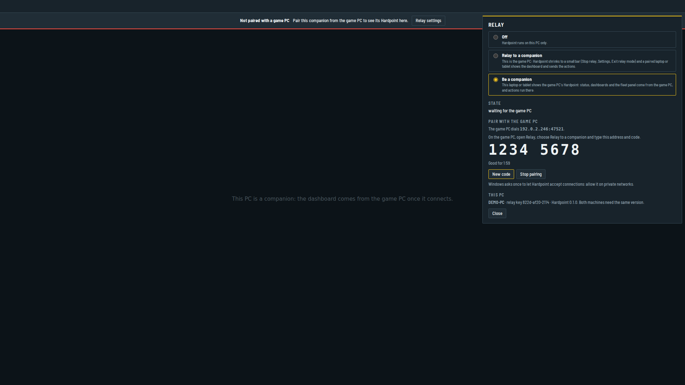
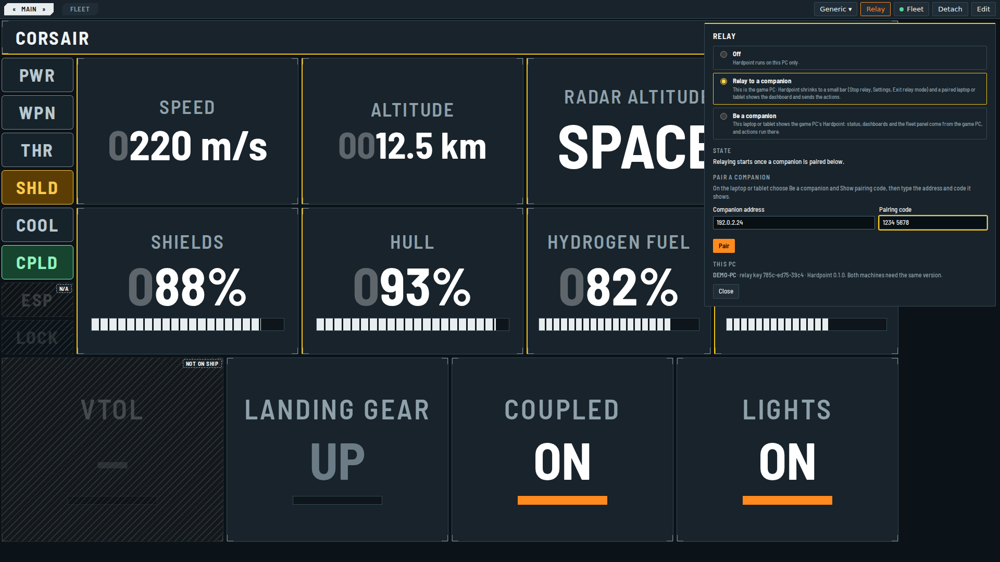
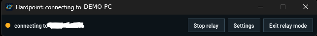

# Companion: use a laptop or tablet as the screen

Companion mode puts the game PC's Hardpoint on a second Windows machine, such as a laptop or a
tablet beside you. The game PC keeps reading the game and doing the work; the companion shows its
dashboards and fleet panel and sends your clicks back. The game PC itself shrinks to a small bar,
so it spends nothing on drawing dashboards.

Both machines run Hardpoint, and both must run **the same version**.

## Pair a laptop

Do this once. After that the two find each other by themselves.

**On the laptop (the companion):**

1. Start Hardpoint and press **Relay** in the top bar.
2. Choose **Be a companion**.
3. The first time, Windows asks to let Hardpoint accept connections. Allow it on **private**
   networks.
4. Press **Show pairing code**. The panel shows an 8-digit code such as `4821 7730`, good for
   2 minutes and only while it is shown, and the address the game PC should dial.

**On the game PC:**

5. Press **Relay** and choose **Relay to a companion**.
6. Type the laptop's address under **Companion address** (its name or IP; add `:port` if it is not
   47521), and the code under **Pairing code**.
7. Press **Pair**.

**Back on the laptop:**

8. The laptop shows the game PC's name and key fingerprint: "<name> wants to pair". Press
   **Pair**.

The game PC now relays to the laptop. A wrong code fails on both sides without saying which was
wrong; three wrong codes stop pairing until you show a new code.

You can choose **Relay to a companion** before you pair. Hardpoint then says "Relaying starts
once a companion is paired below" and starts as soon as pairing succeeds.

## The relay bar on the game PC

In relay mode the game PC shows only a small bar, with the link's status, such as "relaying to
laptop" or "connecting to laptop (retry in 4 s)", and three buttons:

| Button | Key | What it does |
|---|---|---|
| **Stop relay** (or **Connect** when not linked) | D | Breaks or makes the link |
| **Settings** | S | Opens the full window at its Relay panel. Closing it goes back to the bar |
| **Exit relay mode** | X, or the close box | Back to the full window and your detached tabs |

The keys work while the bar has focus. The same actions are in the tray menu: **Relay: stop
relay** (or connect), **Relay settings** and **Exit relay mode**. Detached tabs close while
relaying.

Next time you start Hardpoint on the game PC in relay mode, it goes straight to the bar and dials
the laptop.

## What works from the companion

Almost everything, as if you sat at the game PC:

- Status, values, dashboards, themes and time settings.
- Buttons and toggles: they run on the game PC, with the same hold-to-confirm it times itself.
- Editing dashboards, export and import, sequences.
- The fleet panel as the game PC sees it: join, connect, leave and what you send. The fleet
  connection, the fleet key and the Fleet tab layouts are the game PC's; the companion keeps none
  of its own. A change to the fleet or to what you share shows for 10 s on the game PC's bar.
- **Open in CIC** opens in the companion's browser, not on the game PC.

Not from the companion:

- Choosing displays for detached tabs and mapping bezel buttons (those belong to the game PC's
  screens and controllers).
- The other machine's relay settings: pairing is set on each machine itself.
- Hosting a peer-to-peer fleet: "Hosting is set on the game PC itself".

To protect against lag, the game PC refuses an action from the companion that is more than 1 s
old, and takes at most 5 actions a second over the link.

## When the link drops

- If the laptop sleeps or loses Wi-Fi, the game PC keeps trying (1 s, doubling to 30 s) and its
  bar says "connecting to <name> (retry in N s)".
- If the game PC goes away, the laptop shows a banner, "Lost <name>": "Waiting for <name> to
  connect; actions are off until it does". Nothing is queued or replayed.
- When the link comes back, the laptop's pages reconnect to a fresh session. A hold you started
  before the drop does not carry over.

## Network needs

- The game PC dials the laptop on **TCP port 47521** (or the port set on the laptop). The laptop
  must be reachable from the game PC: the same home network is easiest, or a VPN between them.
- Only the laptop needs a firewall rule (the prompt in step 3). The game PC only dials out.
- The link is TLS 1.3, and both sides prove the keys they paired with, so a third machine cannot
  stand in for either.

## Unpair, rename or move

In the Relay panel, under the paired machine:

- **Rename** changes the name shown for it here.
- **Unpair** forgets it; the link closes and you need to pair again with a new code.
- On the game PC, **Only change the address** updates where the laptop is now, with no new
  pairing. If the address now answers with another machine, the bar says "not paired at
  <address>".
- **Pair another companion** replaces the one you have.

## Stream Deck with a companion

Install the [Stream Deck plugin](Stream-Deck.md) on the game PC. The companion has no fleet of its
own, so keys on a deck plugged into the companion read NO FLEET.
