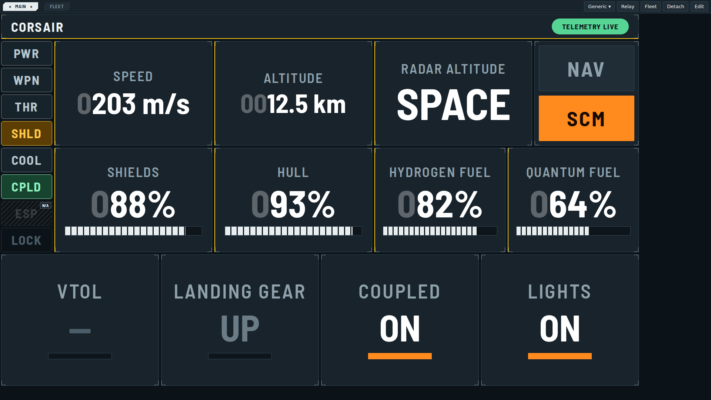
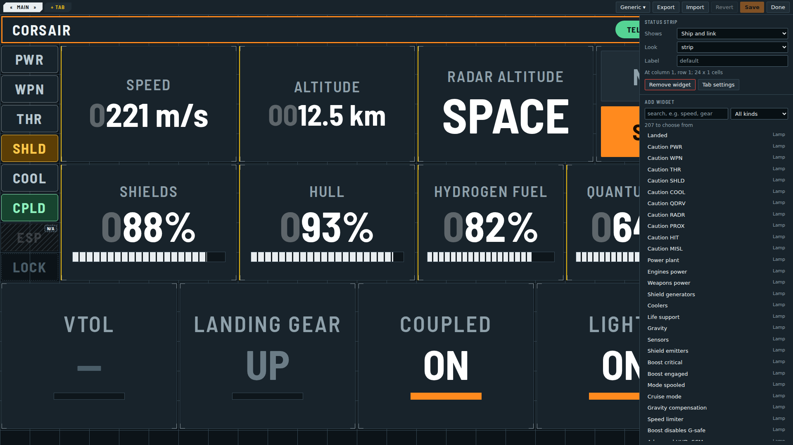
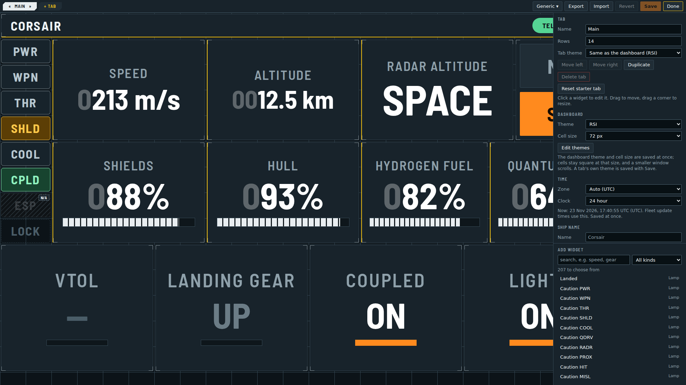
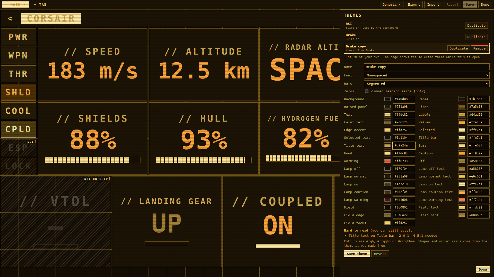
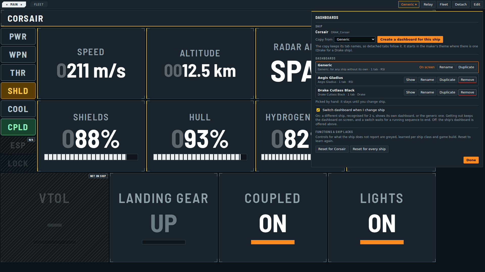
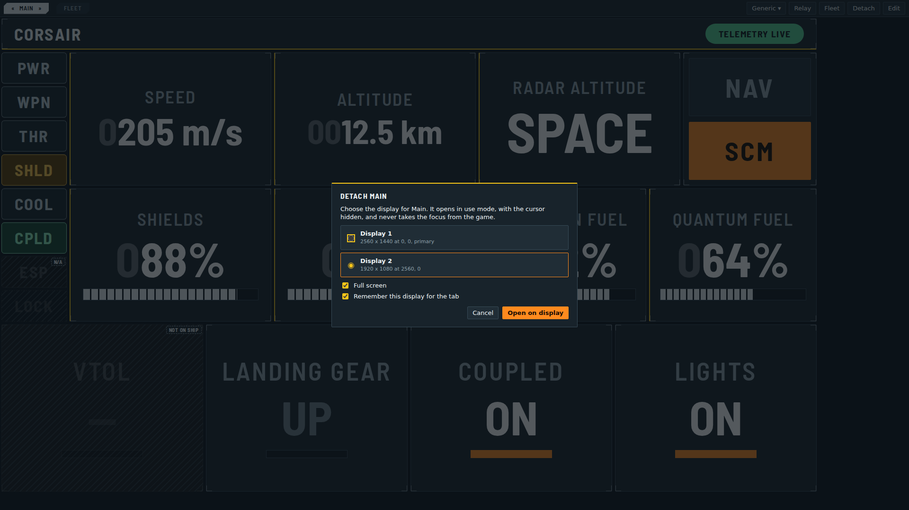
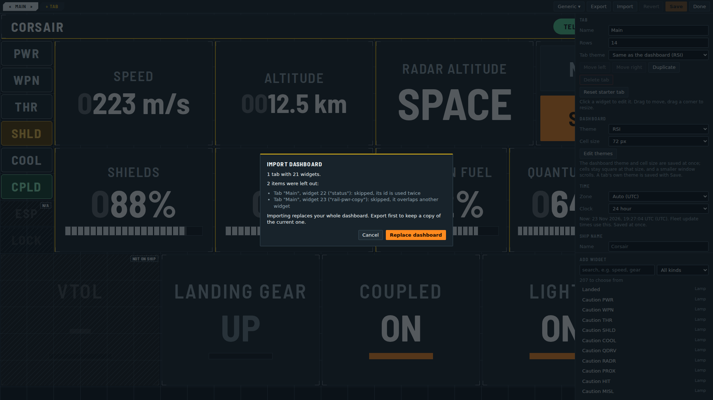

# Dashboards

A dashboard is a set of tabs. Each tab is a grid of widgets that show your ship and character and,
for some, send game actions through the telemetry API when you click or tap them.

## The top bar

| Control | What it does |
|---|---|
| Tabs | Switch tab. The **Fleet** tab appears once you are in a fleet ([Fleet with CIC](Fleet-CIC.md#the-fleet-tab)) |
| Dashboard name with a down arrow | The dashboard picker: the generic dashboard and one per ship ([below](#ship-aware-dashboards)) |
| Detach | Opens this tab in its own window on a display ([below](#detach-a-tab-to-another-display)) |
| Restore detached tabs | Shown when a tab has a remembered display: opens each such tab there |
| Edit | Edit mode ([below](#edit-mode)) |
| Fleet | Shows or hides the fleet panel |
| Relay | Companion settings ([Companion](Companion.md)) |

## Widgets

| Widget | Shows or does | Looks |
|---|---|---|
| Lamp | A caution or an on/off value, as an annunciator lamp | square, round |
| Readout | One value, such as speed or hull | number, bar |
| Toggle | A ship toggle such as gear, lights or doors: shows the real state, a click sets the other state | button, switch, lever (gear only) |
| Action button | One game action | square, round |
| Sequence button | Runs one of your saved sequences | push, square, round |
| Master mode | NAV or SCM | selector |
| Status strip | Telemetry state, ship and the main readings in one line | strip |
| Shield faces | Each shield face's level | outline |
| Power | Each system on or off | columns |
| Weapons | The preset, each weapon's power and ready state, countermeasures | list |
| Fuel | Hydrogen and quantum fuel | bars |
| Configuration | The ship's flight, HUD and gunnery settings | list |

Some actions are in a confirm group: hold the button for 1.5 s to send them. A short press does
nothing, so a stray click or tap cannot fire them.

## Edit mode

1. Press **Edit** in the top bar.
2. To add a widget, pick it from the palette on the right (**Add widget**). It lands on the grid
   at its starting size.
3. To change a widget, select it. The pane shows what it **Shows** (its bind), its **Look**, a
   **Label**, **Invert** where it makes sense, and **Hide when this ship lacks it**.
4. Drag a widget to move it, drag its corner to resize it. **Remove widget** takes it off.
5. Press **Save** to keep the tab, or **Revert** to drop your changes. **Done** leaves edit mode.
   The top bar shows **unsaved** while there are changes.

Limits: up to 20 tabs a dashboard and 200 widgets a tab. No two widgets may overlap.

### Tabs

With no widget selected, the pane shows the tab settings:

- **Name** and **Rows** (4 to 48 rows; the grid is always 24 cells wide).
- **Tab theme**: a theme for this tab only, over the dashboard's.
- **Duplicate**, **Move left**, **Move right** and **Delete tab** (it asks first, and any unsaved
  changes on that tab go with it). A dashboard keeps at least one tab.
- **Reset starter tab** puts the **Main** tab back as shipped.
- **Display and bezel**: the display the tab detaches to and its bezel buttons. These are saved
  at once, not with Save.

## Cell size

Cells are square and keep their size. Choose the size under **Cell size** in the edit pane: 48,
64, 72, 80 or 96 px (72 by default). It is saved at once, for the whole dashboard. A window
smaller than the grid scrolls; the grid never squeezes to fit.

## Themes

Two built-in themes ship with Hardpoint:

- **RSI**: dark slate, white condensed capitals, orange for selected, segmented bars.
- **Drake**: monochrome amber, monospaced capitals, dashed rules.

Choose the dashboard's theme in the edit pane (saved at once). A tab can have its own theme.

To make your own:

1. In the edit pane press **Edit themes**.
2. **Duplicate** a theme (built-in or yours) and give it a name.
3. Change its colours, **Font** (condensed, mono or sans), **Bars** (segmented or solid) and
   **Zeros** (dim leading zeros or not). Its base (RSI or Drake) sets the shapes and stays fixed.
4. Press **Save theme**.

The editor warns with **Hard to read** when text and its background are too close in contrast;
you can still save. You can keep up to 20 themes of your own. Removing one sends the tabs that
used it back to the dashboard's theme.

## Time

Under **Time** in the edit pane choose the **Zone** (Auto uses this PC's) and the **Clock**
(24 or 12 hour). Fleet cards use it for their update times.

## Ship-aware dashboards

Hardpoint knows which ship you are in and learns which functions each ship reports.

**Greyed controls.** A widget for a function your ship does not report is dimmed and hatched
with `NOT ON SHIP` or `N/A`; hover for the reason. Nothing is removed. Tick **Hide when this
ship lacks it** on a widget to hide it instead while you use the dashboard (edit mode still shows
it, marked `HIDDEN IN USE`). Hardpoint remembers what it learned per ship; **Reset for every
ship**, under **Functions a ship lacks**, makes it learn again.

**One dashboard per ship.** Open the dashboard picker (the dashboard's name in the top bar):

1. Get in the ship and press **Create a dashboard for this ship**. It starts as a copy of the
   dashboard you choose under **Copy from**, in the maker's theme where Hardpoint has one (Drake
   for Drake ships, RSI for RSI ships).
2. Change it as you like. The generic dashboard stays as it was.
3. Tick **Switch dashboard when I change ship** to have Hardpoint show the right dashboard when
   you board another ship. Off by default: then the picker offers the ship's dashboard and you
   choose.

A dashboard you pick by hand stays until you change to a different ship. You can rename,
duplicate and remove ship dashboards in the picker; the generic one stays. Up to 40 dashboards.

**Ship name.** In the edit pane, under **Ship name**, give the ship class you are in a name of
your own. The status strip, dashboards and your fleet card use it. **Clear** brings back the
game's name.

## Detach a tab to another display

1. Go to the tab and press **Detach**.
2. Choose the display it opens on. Keep **Remember this display for the tab** ticked to have it
   open there next time.
3. Press **Open on display**.

A detached tab shows the tab only: no tab bar or edit controls, and the cursor hides after 2 s.
Edits you make in the main window show there at once.

- **Kiosk menu:** hold Escape, or the top left corner, for 2 s. It offers back to the tab, map
  bezel buttons, full screen, open the full dashboard and close the window.
- **Restore detached tabs** (top bar or tray) opens every remembered tab on its display. A display
  that is not connected is listed as such.
- Displays are remembered by name. A display with no name cannot be remembered, and two with the
  same name cannot be told apart.
- The **Fleet** tab detaches too; its display is chosen each time.

### Bezel buttons

Displays with bezel buttons (MFD frames that show up as a game controller) can drive a detached
tab:

1. Open the kiosk menu on the detached tab, or **Display and bezel** in the tab settings, and
   choose **Map bezel buttons**.
2. Press any bezel button: that picks the controller.
3. Press each button you want to map and choose what it does: an action, a sequence, a toggle
   (to a given state, or as a click) or master mode.
4. **Clear** removes one button, **Clear all** removes every one, **Relearn on another
   controller** starts again with the next controller you press.

Each change is saved at once.

## Import and export

- **Export** (in edit mode) saves the dashboard on screen as a JSON file.
- **Import** reads a file and first shows a summary: how many tabs and widgets, what it would
  leave out and why, and how many buttons send confirm-group actions. Nothing changes until you
  confirm. Confirming replaces the dashboard on screen.

An import keeps what it understands and lists the rest. It can name themes, but it cannot add
them: a theme name you do not have is left out. Files are at most 512 KiB.

Going back to an older Hardpoint build? Export first. A build from before ship dashboards cannot
read the newer file and writes over it at its first change; Hardpoint keeps the older file as
`dashboards.json.bak` in the settings folder.
