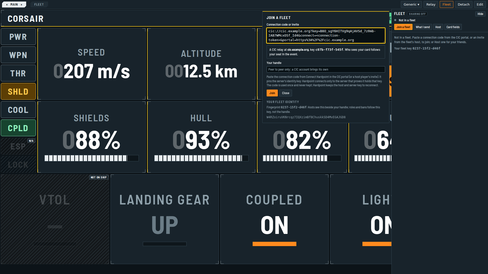
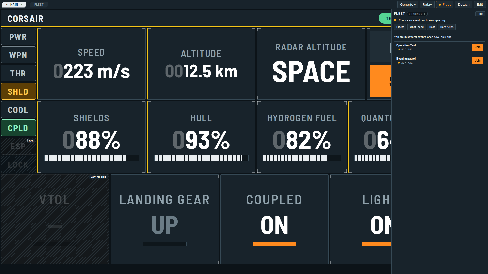
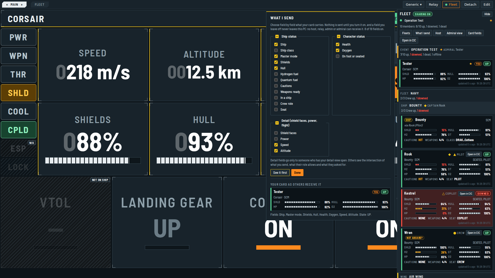
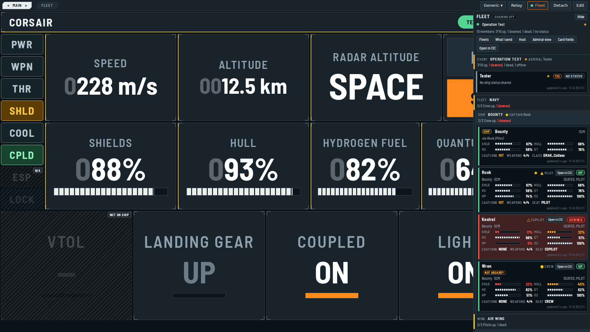
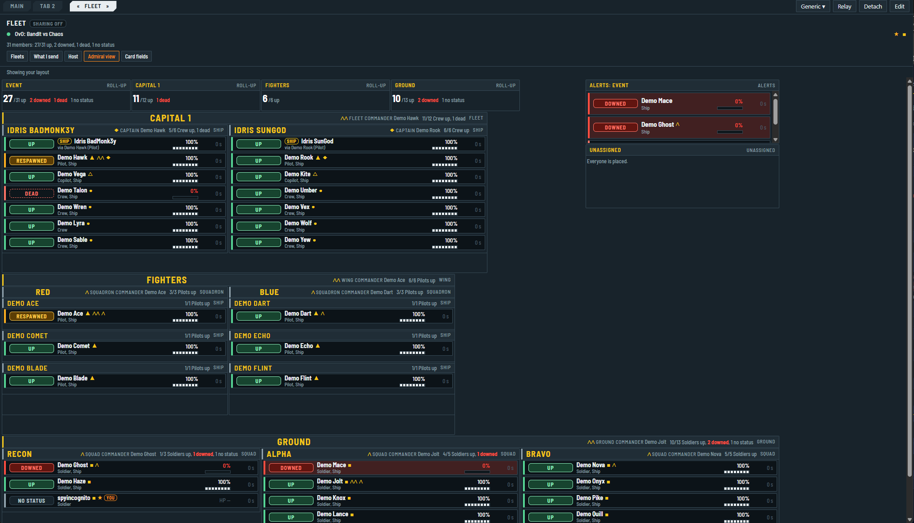
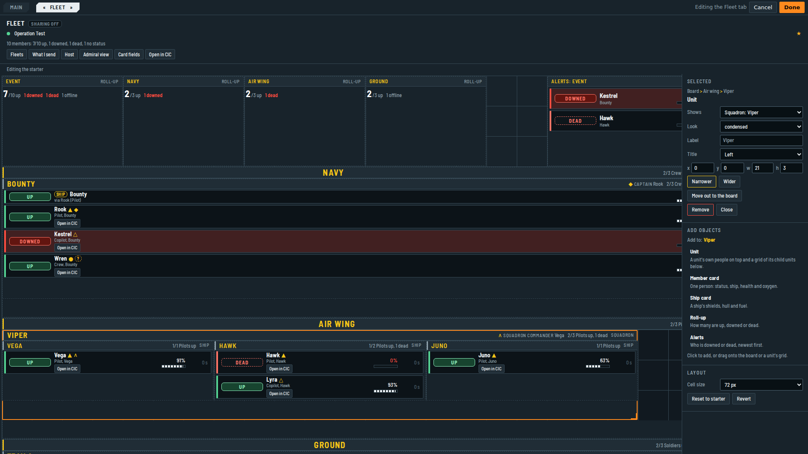

# Fleet with CIC

CIC is a fleet server an org runs for its events. Everything before the event happens in CIC's
web portal: you sign up, pick your unit, and the admiral and commanders give out roles. Hardpoint
joins in only on event day, with a connection code from your CIC account.

The CIC side (signing up, events, units and roles) is described in the CIC project's own wiki.
This page covers the Hardpoint side.

## Connect to an event

You need a CIC account, signed up for an event that is open.

1. In the CIC portal, open **Account** and press **Make a connection code**. It shows a string
   that starts with `cic://`, once. It is good for 12 hours.
2. In Hardpoint, press **Fleet** in the top bar to open the fleet panel, then **Join a fleet**.
3. Paste the code into **Connection code or invite**. Hardpoint reads it at once and shows
   "A CIC relay at cic.example.org, key ..." so you know where it goes. Leave **Your handle**
   empty: your CIC account brings its own.
4. Press **Join**.

The code pins the server's identity key: Hardpoint connects only to a server that proves it holds
that key. The code is used once and never written down. Its first use links this Hardpoint's
fleet key to your account; for the next 12 hours Hardpoint reconnects by that key, with no new
code, even after a restart.

### Choosing the event

- If you are signed up for one open event, Hardpoint joins it.
- If you are in several, the panel says "You are in several events open now, pick one." Choose
  one.
- A new connection code always asks again, even if you joined another event before.

## What you share

Nothing is sent until you turn it on. Press **What I send** in the fleet panel.

| Group | Fields |
|---|---|
| Ship status | Ship, Ship class, Master mode, Shields, Hull, Hydrogen fuel, Quantum fuel, Cautions, Weapons ready, In a ship, Crew role, Seat |
| Character status | Health, Oxygen, On foot or seated; with any of these, also your state (UP, DOWNED, DEAD) |
| Detail (shield faces, power, flight) | Shield faces, Power, Speed, Altitude |

- Tick a whole group or single fields. Each change applies at once.
- A field you leave off never leaves your PC. No relay, admin or admiral can receive it.
- Detail fields go only to someone who has your detail view open at that moment.
- Each viewer gets what you send, cut down to what their role allows and what they chose to show.
- With nothing ticked, your card still carries your handle and fleet key, so others see you are
  connected.
- Your aUEC balance, keybinds and sequences are never put on a card.

Press **See it first** to see your card exactly as it would leave your PC now. The panel header
says **Sharing on** or **Sharing off**.

### Who sees your card

That follows your place in the event, set in the CIC portal:

- People in your own unit, and anyone who leads a unit above yours, see your card.
- The admiral sees everyone.
- While you are **Unassigned** (not placed in a unit yet), your card goes to nobody; you see your
  own card only, until someone places you.
- A captain sees their own ship and crew. Pilots and copilots in a squadron see their squadron.

## The fleet panel

From the top:

- **Header**: Sharing on or off, the event's name and your role icons, and a roll-up of everyone
  you can see, such as "12 members: 10/12 up, 1 downed, 1 dead".
- **Fleets**: the fleets you joined, with Connect and Leave.
- **What I send**: your consent, above.
- **Admiral view**: shown when your role is above member. The same units condensed: one row per
  member, roll-ups per unit, downed first.
- **Card fields**: what the cards in your panel show. This also decides what you ask others for.
- **Open in CIC**: opens the event's page in the CIC portal in your browser.

The body is the event's unit tree as you see it: fleets, wings and ground forces, then ships,
squadrons and squads. Each unit shows its lead, its seats (cards, or "not connected yet" for
someone signed up who has not connected), and a labelled roll-up such as "5/6 Crew up". Units
above yours show their name and lead only.

- **Cards**: a member's status (UP, DOWNED, DEAD, RESPAWNED) and the fields they share. A
  member with no new card for 10 s shows as OFFLINE. Downed members sort first.
- **Ship cards**: a fleet's ships get one card for the ship, built by CIC from its Pilot, then
  its Copilot, then crew standing in. It says where it comes from, such as "via Rook (Pilot)".
- **Squadrons**: a squadron's ship is its Pilot's own card, with the Copilot's under it.
- **Unassigned**: the admiral and commanders see a list of members not placed yet, by name only.
- Click a card to open its detail view: shield faces, power, speed and altitude, when the member
  shares them.

### Seats, roles and units

These are changed in the CIC portal, not in Hardpoint. Use **Open in CIC**: the admiral and
commanders also get it on seated members and on Unassigned entries, which opens the event page
where they can move them. Changes show in every panel at once.

## The Fleet tab

The same fleet view at full size, as a tab beside your dashboard tabs. Click **Fleet** in the tab
bar. It is a board of nested unit grids, like the CIC Live board: each unit object shows its own
people on top and a grid of its child units below.

Hardpoint starts you with a layout for your rank: the admiral gets roll-ups, alerts and every top
unit; a commander their units; a seat or lead their own unit.

### Arrange it

Edit needs a window at least 900 px wide.

1. On the Fleet tab, press **Edit**. The top bar says **Editing the Fleet tab**.
2. Click a unit's header to select it. The pane shows **Selected** with its settings: what it
   **Shows**, its **Look**, a **Label**, its position and size, **Narrower** and **Wider**.
3. Under **Add objects**, the pane says where new objects go (**Add to:** the selected unit, or the
   board). Click an object to add it, or drag it onto the board or into a unit's grid:
   - **Unit**: a unit's people and its child units.
   - **Member card**, **Ship card**: one person or one ship.
   - **Roll-up**: how many are up, downed or dead, for the event or a unit.
   - **Alerts**: who is downed or dead, newest first.
   - **Unassigned**: members not placed yet.
4. **Move out to the board** and **Put back in its unit** move an object between grids.
   **Default cards inside** puts a unit's grid back to its own child units.
5. **Units not on the board** lists units your layout leaves out; click one to place it.
6. Under **Layout**, choose the **Cell size** (48 to 96 px), **Reset to starter** or **Revert**.
7. Press **Done** to save, or **Cancel**.

Layouts are saved per CIC event, plus one for peer-to-peer sessions, in `fleet-layout.json`. They
hold positions and labels only, never card data. The Fleet tab detaches into its own window like
any tab.

## Leave or reconnect

- If the connection drops, the panel says "Fleet offline, trying again in N s" and reconnects by
  itself (1 s, doubling to 30 s).
- After 12 hours, or on another PC, make a new connection code in the portal.
- **Leave** (under **Fleets**) tells the server and forgets the event here.
- A refusal is not retried. The panel shows why and what to do; see
  [Troubleshooting](Troubleshooting.md#cic-refusals).
