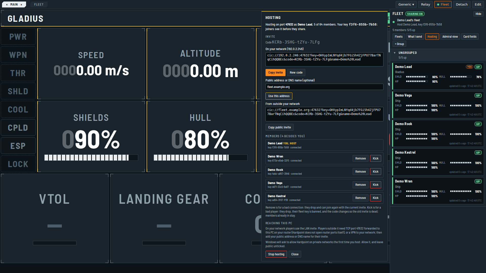
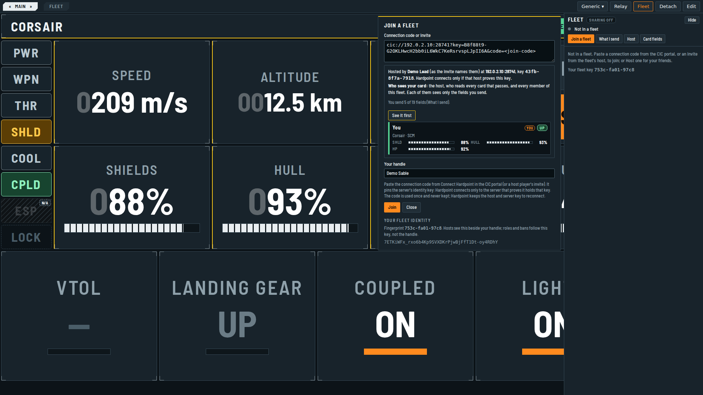
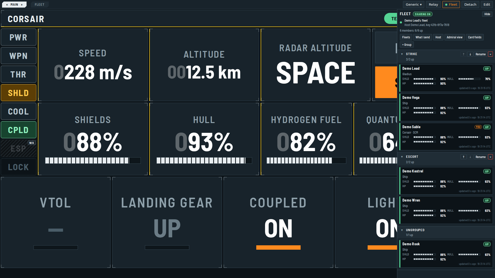

# Peer to peer: host or join a fleet

No server needed: one player hosts a fleet from their own Hardpoint, and friends join with the
host's invite. Everyone sees everyone's card, each with only the fields its sender chose. There
are no units or roles. Each player sorts the cards into groups of their own, in their own panel.

The host's only powers are moderation: Remove, Kick and a new code.

## Host a fleet

Hosting runs on the game PC itself (not from a companion).

1. Open the fleet panel (**Fleet** in the top bar) and press **Host**.
2. Enter **Your handle** (1 to 40 characters). Leave **Port** at 47522 unless you need another
   (1024 to 65535).
3. Press **Start hosting**. Hosting leaves any other fleet you are connected to.
4. The first time, Windows asks to allow Hardpoint through the firewall. Allow it on **private**
   networks and leave public unticked.

The Hosting panel then shows:

- "Hosting on port 47522 as <handle>, N of 64 members", and your key's fingerprint. Joiners see
  that fingerprint before they share anything.
- **Invite**: the code, and the invite for players **On your network** with **Copy invite**.
- **Public address or DNS name (optional)** for players outside your network (below).
- **Members**, each with **Remove** and **Kick**, and **Banned** if you have banned anyone.
- **Stop hosting**: ends the session; members are told and dropped.

Send the invite to your friends over a private channel. It looks like
`cic://192.0.2.20:47522?key=...&code=Q7mK-2xPa-Lr9T-c4Wd&name=...`.

The session lasts while your Hardpoint stays open. After a restart, players need a new invite
(bans are kept).

## Players outside your network

On your own network, players use the LAN invite. For anyone else, either:

- **Forward the port.** On your router, forward TCP port 47522 (or the port you chose) to this
  PC. Hardpoint does not open router ports itself. Then type your public address or a DNS name
  under **Public address or DNS name** and press **Use this address**. Copy the invite under
  **From outside your network** with **Copy public invite**.
- **Use a VPN** to your network, and give them the LAN invite.

What protects a host that is open to the internet: TLS 1.3, your pinned fleet key, the 95-bit
code, and limits on how fast and how many can try. Ten wrong codes from one address in ten
minutes lock that address out for a while. There is no address filter, since your friends may be
anywhere.

## New code, Remove, Kick and bans

| Button | When to use it | What happens |
|---|---|---|
| **New code** | An invite went further than you meant | The old invite stops working at once. Members already in stay |
| **Remove** | A bad connection | They drop and can join again with the current invite |
| **Kick** | A bad player | They drop, their fleet key is banned, and the code changes so the invite they had is dead. Members already in stay |
| **Lift** (under **Banned**) | You want to let a banned player back | Their key may join again with the current invite |

Bans follow the player's fleet key, not their handle. They outlast the session and a restart of
your Hardpoint, until you lift them. Share the new invite with the members you want to keep
after a Kick or a New code; members already connected do not need it.

## Join a friend's fleet

1. Open the fleet panel and press **Join a fleet**.
2. Paste the invite into **Connection code or invite**. Hardpoint shows who you are joining:
   "Hosted by <handle> at <address>, key <fingerprint>". Hardpoint connects only if that host
   proves this key. Check the fingerprint with your friend if in doubt.
3. Read **Who sees your card**: the host, who reads every card that passes, and every member of
   this fleet. Each sees only the fields you send.
4. Press **See it first** to see your card as it would leave your PC, and **What I send** to
   change it (see [Fleet with CIC](Fleet-CIC.md#what-you-share); it works the same here).
5. Enter **Your handle** and press **Join**.

If someone in the fleet already has your handle, Hardpoint gives you the handle with `-2` (or
`-3`, and so on) and shows the one you got.

If your connection drops, Hardpoint rejoins by your fleet key, even after the host makes a new
code. If the host's Hardpoint restarted, you need a new invite from them.

## Your own groups

In a peer-to-peer fleet the host sends no units, so every player (the host too) groups the cards
in their own panel. Nothing about your groups is sent to anyone.

1. Press **+ Group** in the fleet panel and name it.
2. Drag cards into the group ("Drag cards here" shows in an empty one).
3. Use the arrows to move a group up or down, **Rename** to rename it, the chevron to collapse it,
   and the remove button to delete it (its members go back to Ungrouped).

Up to 20 groups, each with up to 64 members. **Card fields** chooses what the cards show, and
**Admiral view** condenses the groups to one row per member. The Fleet tab shows your groups as
units on a board too (see [Fleet with CIC](Fleet-CIC.md#the-fleet-tab)); there is one Fleet tab
layout for all peer-to-peer sessions.

A player the host removes or kicks drops out of everyone's panel at once.

## Limits

- Up to 64 members, the host included.
- No automatic router setup (UPnP): forward the port by hand, or use a VPN.
- Refusals and their hints: [Troubleshooting](Troubleshooting.md#peer-to-peer-refusals).
