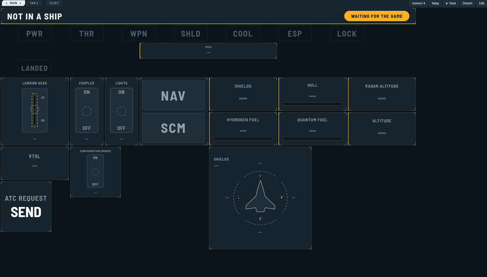
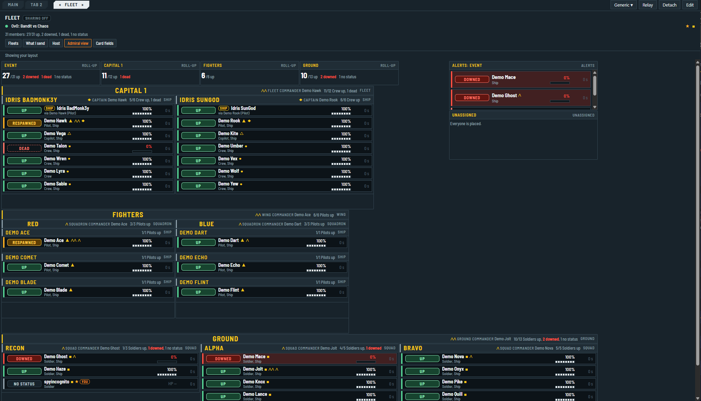

# Hardpoint

Your ship's status on your own screens, and your fleet's status beside it.

Hardpoint is a Windows app for Star Citizen players. The game serves a local telemetry API on
your PC; Hardpoint reads it and turns it into dashboards you arrange yourself, on your main
screen, on a second display, or on a laptop or tablet beside you. Shields, hull, fuel, power,
weapons, cautions and your ship's settings sit where you want them, and each ship can have its
own dashboard that comes up when you board.

When you fly with others, Hardpoint puts you in the fleet. Join your org's event on a CIC server
with a connection code, or host a small fleet for friends from your own PC with no server to run.
Everyone's status card shows up by fleet, wing and squad, with roll-ups and alerts for who is
down, as your role allows.

Why players use it:

- **Your screen, your layout.** Tabs of widgets on a grid, themes, detached tabs on other
  displays, and a laptop or tablet as a companion screen.
- **You choose what you share.** Nothing about you leaves your PC until you turn it on. In a
  fleet you pick, field by field, what your card carries, and a field you leave off is never
  sent to anyone: not the host, not the CIC server, not an admin or admiral. Your aUEC balance,
  keybinds and sequences are never put on a card. See
  [What you share](Fleet-CIC.md#what-you-share).
- **API only.** Everything Hardpoint shows comes from the game's telemetry API, and every button
  on a dashboard goes through that same API. It presses no keys and changes no game files.

## Who it is for

- **Pilots and crew** who want a clear ship display laid out the way they like.
- **Groups of friends** who want to see each other's status during a session, with no server to
  run: one player hosts from their own PC.
- **Orgs running events** on a CIC server, where an admiral and commanders build units and roles
  before the event, and members connect Hardpoint on the day.

## Pages

| Page | What it covers |
|---|---|
| [Install and set up](Install-and-setup.md) | Download, verify the hash, first run, the tray, the settings folder, firewall prompts |
| [Dashboards](Dashboards.md) | Tabs, widgets, edit mode, themes, cell size, ship dashboards, detached tabs, import and export |
| [Fleet with CIC](Fleet-CIC.md) | Join an org's event with a connection code, what you share, the fleet panel and the Fleet tab |
| [Peer to peer](Fleet-P2P.md) | Host a small fleet from your own PC, or join a friend's |
| [Companion](Companion.md) | Show and use the game PC's Hardpoint on a paired laptop or tablet |
| [Stream Deck](Stream-Deck.md) | Hardpoint Fleet Status, an optional plugin with read-only fleet status keys |
| [Troubleshooting](Troubleshooting.md) | When something does not work |
| [FAQ](FAQ.md) | Short answers |
| [Coming soon](Coming-soon.md) | What we are working on next |
| [For AI agents](For-AI-agents.md) | A summary and the key facts, for tools that read these docs |

## Start here

1. [Install and set up](Install-and-setup.md) Hardpoint on your game PC.
2. Build your first dashboard: [Dashboards](Dashboards.md).
3. Fly with others: [Fleet with CIC](Fleet-CIC.md) or [Peer to peer](Fleet-P2P.md).
4. Something not working? See [Troubleshooting](Troubleshooting.md) and the [FAQ](FAQ.md).

## Licence and disclaimer

Copyright 2026 Spy Incognito Games. Licensed under the Apache License, Version 2.0; see
[`LICENSE`](../../LICENSE) and [`NOTICE`](../../NOTICE).

Hardpoint is provided "as is", without warranties or conditions of any kind, and the authors
accept no liability for any damage arising from its use (Apache 2.0, sections 7 and 8). You
install and run it at your own risk. As with any public repository, review the code and verify
the release before you run it.
