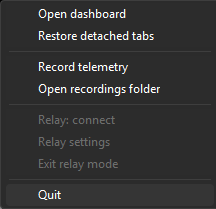
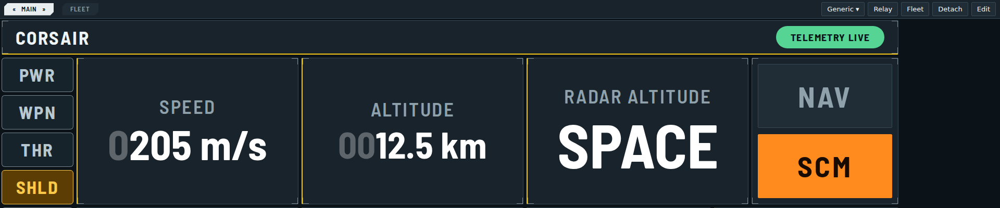

# Install and set up

Hardpoint is one program, `hardpoint.exe`: a Windows exe that runs a Rust application. There is
no installer: download it, check it, and run it.

**Heads-up: the exe is not code-signed.** Windows SmartScreen may warn the first time you run it
(see [First run](#first-run)). With no signature to vouch for the file, the hash check below is
how you know the exe you run is the one the release built. Do it before the first run of each
new version.

## What you need

- A Windows PC that runs Star Citizen.
- The game's local telemetry API. The game serves it on `127.0.0.1:2942`, on the same PC.
  Hardpoint only reads from it and calls it there; it changes no game files.

## Turn on the game's telemetry API

The game serves its telemetry API only when it is switched on. How depends on the game version.

**Game 4.x (LIVE):** set a Windows user environment variable. In a Command Prompt or PowerShell:

```text
setx GRPC_CLIENT_SERVER_ENABLED true
```

Then fully quit the RSI Launcher (from its tray icon too) and start it again, then the game. The
game takes its environment from the launcher, so restarting only the game is not enough. On 4.x
the API is display only: dashboards,
lamps and readouts work, but action buttons, toggles and sequences need game 5.0.

**Game 5.0 (PTU, and LIVE once 5.0 ships):** add a line to `user.cfg` in the game's `PTU` (or
`LIVE`) folder. If there is no `user.cfg`, create it.

```text
server.game.telemetry.enabled=1
```

Then start (or restart) the game.

**What each version sends.** From recordings on 4.x LIVE and 5.0 PTU (23 Nov 2026):

| | 4.x LIVE | 5.0 PTU |
|---|---|---|
| Character: health, oxygen, temperature and the rest of the vitals | Yes | Yes |
| Ship: name, lights, doors, landing gear, power, flight readouts | Yes | Yes |
| Weapons and countermeasures | Yes | Yes |
| Ship shields (face strengths and level) | No | Yes |
| Ship hull health | No | Yes |
| Master mode (NAV / SCM) | No | Yes |
| Action buttons, toggles and sequences | No | Yes |

Widgets for something the game does not send stay empty on that version.

**Check it is on:** Hardpoint's status strip shows **Telemetry live**, and the game's log
(`Game.log` in the game folder) shows:

- 4.x LIVE: `Service sc.game.telemetry.v1.GameTelemetryService registered` and
  `127.0.0.1:2942 [Insecure]`.
- 5.0 PTU: `Local services server is running on 127.0.0.1:2942`.

## Download and check

Releases are at
[github.com/SpyIncognito/cic-hardpoint/releases](https://github.com/SpyIncognito/cic-hardpoint/releases).
Each one is built from a version tag by the repository's release workflow on a GitHub-hosted
Windows runner, and holds three files:

| File | What |
|---|---|
| `hardpoint.exe` | The app |
| `games.spyincognito.hardpoint.fleet.streamDeckPlugin` | The optional Stream Deck plugin ([Stream Deck](Stream-Deck.md)) |
| `SHA256SUMS` | The SHA-256 hash of both files |

1. Download `hardpoint.exe` and `SHA256SUMS` from the latest release.
2. Check the file. In PowerShell, in the download folder:

   ```powershell
   Get-FileHash .\hardpoint.exe -Algorithm SHA256
   ```

   The hash must match the line for `hardpoint.exe` in `SHA256SUMS` (letter case does not matter).
   If it does not, delete the file and do not run it.
3. Optional: each release also has a build provenance attestation, which shows the file was
   built by the repository's release workflow. With the GitHub CLI:
   `gh attestation verify hardpoint.exe --repo SpyIncognito/cic-hardpoint`.
4. Put `hardpoint.exe` wherever you keep programs, for example a `Hardpoint` folder in your
   user folder.

### Or build it yourself

A source build lets you review the code and run an exe you built. The build commands are in the
repository README, under [Build from source](../../README.md#build-from-source).

## First run

1. Double-click `hardpoint.exe`.
2. The exe is not code-signed yet, so Windows SmartScreen may show "Windows protected your PC"
   the first time. Choose **More info**, check that the name is `hardpoint.exe`, then **Run anyway**.
3. A short splash shows while Hardpoint starts, then the dashboard window opens with the
   starter tab, **Main**.
4. Hardpoint also puts an icon in the tray. Closing the window leaves it running there; use the
   tray icon's menu to open the dashboard again or to quit.



Only one Hardpoint runs at a time. Starting it again brings the running one's dashboard to the
front.

### Is it reading the game?

The status strip at the top of the dashboard tells you:

| It says | Meaning |
|---|---|
| Telemetry live | The game is sending data |
| Waiting for the game | Hardpoint is running, the game's telemetry API has not answered yet |
| Telemetry off | The telemetry link is idle |

Most widgets need you to be in a ship. A widget for something your ship does not report is
dimmed with `NOT ON SHIP` or `N/A` (see [Dashboards](Dashboards.md#ship-aware-dashboards)).



## The tray menu

| Item | What it does |
|---|---|
| Open dashboard | Shows the dashboard window |
| Restore detached tabs | Opens each tab you placed on a display, on that display |
| Record telemetry | Records the game's telemetry to a file, for replay or a bug report. Recordings are scrubbed: your aUEC balance and ship, seat and weapon names are taken out. REC shows on the status strip while it runs |
| Open recordings folder | The `recordings` folder in the settings folder |
| Relay items | Only in relay mode; see [Companion](Companion.md) |
| Quit | Stops Hardpoint |

## Settings folder

Everything Hardpoint keeps is in one folder:

```text
%APPDATA%\Hardpoint
```

Paste that into the Explorer address bar to open it. The main files:

| File | What |
|---|---|
| `dashboards.json` | Your dashboards, tabs and widgets |
| `themes.json` | Your own themes |
| `app-settings.json` | Splash, time display, relay mode and hosting settings |
| `ship-support.json` | What Hardpoint learned about which functions each ship reports |
| `fleet-identity.key` | Your fleet key (keep it private; it is what fleets know you by) |
| `fleets.json` | Fleets you joined: address, server key and handle, never a code |
| `fleet-consent.json` | What your card sends |
| `fleet-view.json` | Your own groups and card fields in the fleet panel |
| `fleet-layout.json` | Your Fleet tab layouts |
| `fleet-bans.json` | Players you banned while hosting |
| `relay-identity.key`, `relay-peers.json` | Companion pairing |
| `recordings\` | Telemetry recordings |

To back up your setup, copy the folder while Hardpoint is closed. To move dashboards only, use
**Export** and **Import** instead (see [Dashboards](Dashboards.md#import-and-export)).

If you used an earlier build that kept its settings in `%APPDATA%\sc-key-emulator`, Hardpoint
copied them to the new folder once, on its first start, and left the old folder as a backup.
The Stream Deck plugin still finds Hardpoint through `%APPDATA%\sc-key-emulator\bus.json`, so
leave that folder in place.

### Turn off the splash

In `app-settings.json`, set `"splash": false`. Or start Hardpoint with `hardpoint.exe --no-splash`.

## Firewall prompts

Hardpoint talks to the game and to its own windows on `127.0.0.1` only, which needs no firewall
rule. Windows asks about the firewall only when Hardpoint starts listening for other machines:

| When | Why | What to choose |
|---|---|---|
| You start hosting a peer-to-peer fleet | Friends connect to your PC on TCP port 47522 | Allow on **private** networks; leave public unticked |
| You turn on **Be a companion** on a laptop | The game PC connects to it on TCP port 47521 | Allow on **private** networks |

Joining a CIC event or someone else's fleet, and relaying from the game PC, only make outgoing
connections: no prompt.

The prompt is a Windows Defender Firewall dialog naming Hardpoint. Tick **Private networks**,
leave **Public networks** unticked, and choose **Allow access**.

If you chose wrong, open **Windows Security**, then **Firewall & network protection**, then
**Allow an app through firewall**, and fix the entry for Hardpoint.

## Next

- [Dashboards](Dashboards.md): make the screen your own.
- [Fleet with CIC](Fleet-CIC.md) or [Peer to peer](Fleet-P2P.md): fly with others.
- [Companion](Companion.md): use a laptop or tablet as the screen.
