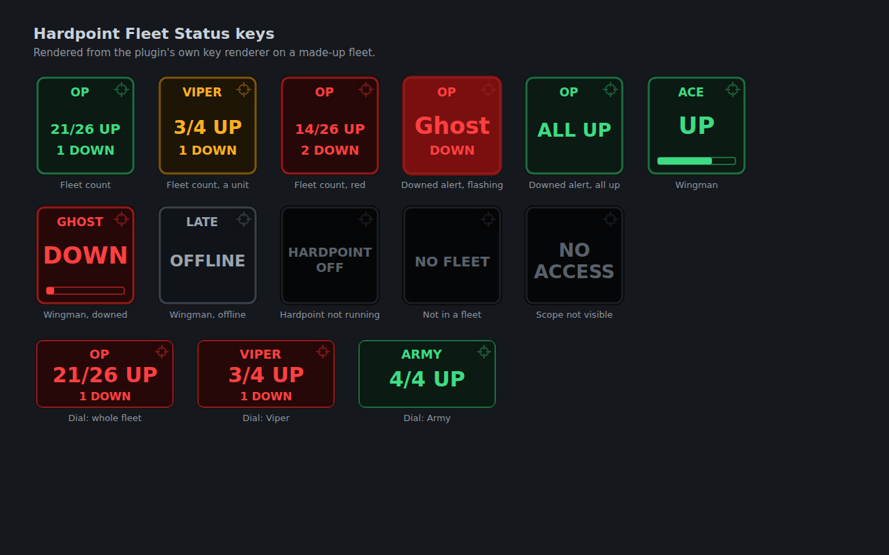
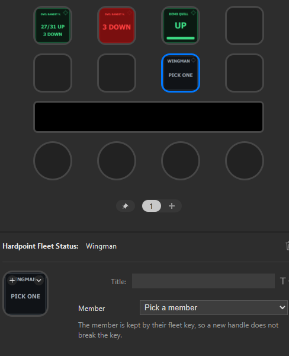
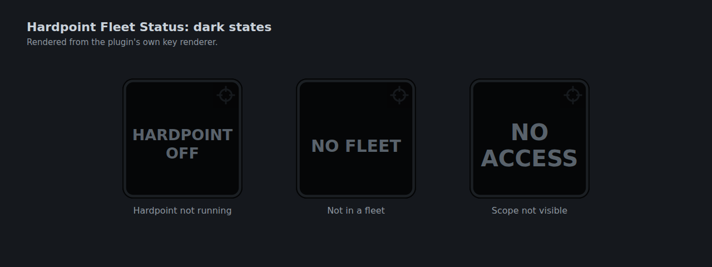

# Stream Deck: Hardpoint Fleet Status

Hardpoint Fleet Status is an optional Stream Deck plugin that puts your fleet's state on keys. It
is status only: four read-only keys, no controls, no sound and no game input. It talks only to
Hardpoint on the same PC, never to a fleet server or other players, and holds no credentials.

## What you need

- Windows 10 or later.
- Stream Deck 7.1 or later, from Elgato.
- Hardpoint running on the same PC (the game PC, not a companion).

## Download

The plugin is published with each Hardpoint release on the repository's
[GitHub releases page](https://github.com/SpyIncognito/cic-hardpoint/releases), next to
`hardpoint.exe`. Download `games.spyincognito.hardpoint.fleet.streamDeckPlugin` and
`SHA256SUMS`, and check the plugin's SHA-256 against its line in `SHA256SUMS` (in PowerShell:
`Get-FileHash games.spyincognito.hardpoint.fleet.streamDeckPlugin`).

## Install

1. Install or update the Stream Deck app.
2. Double-click `games.spyincognito.hardpoint.fleet.streamDeckPlugin`. Stream Deck asks to install
   it; accept.
3. In Stream Deck, open the **Hardpoint Fleet Status** category and drag keys onto your deck.
4. Select each key and pick its scope or member in the settings panel below the deck.
5. Start Hardpoint and join a fleet. The keys light up.

No network access is needed: the plugin and Hardpoint talk on `127.0.0.1`. To remove the plugin,
open Stream Deck's **Preferences**, then **Plugins**, select it and uninstall it.

## The keys

| Key | Shows | Press | Settings |
|---|---|---|---|
| **Fleet count** | How many are up in a scope, such as "21/26 UP", with "N DOWN" under it when anyone is down. Green, amber or red by your thresholds | Asks Hardpoint for the status now; the key shows a tick | **Scope**: the whole fleet, a unit or one of your groups. Amber below (default 80%), red below (default 60%) |
| **Downed alert** | "ALL UP" while nobody in scope is down. When someone goes down it flashes red with their handle, or "N DOWN" if several are | Acknowledges the alert and stops the flash; the key stays red while anyone is down. A new downing flashes again | **Scope**. Count DEAD as well as DOWNED (default on) |
| **Wingman** | One member: UP, DOWN, DEAD or OFFLINE, and a health bar when they share health | Nothing | **Member**, picked from the members Hardpoint shows you. Kept by their fleet key, so a new handle does not break it |
| **Group roll-up dial** (Stream Deck +) | A scope's counts on the dial screen, such as "VIPER 3/4 UP 1 DOWN" | Turn: next or previous scope. Press or tap: back to the whole fleet | Which scopes to step through (none chosen: all you can see) |

The keys see exactly what your own fleet panel sees, filtered by your role the same way. In a
CIC event the scopes are the event and its units; in a peer-to-peer fleet they are the whole
session and your own groups.

Acknowledging an alert is local to the key; nothing is sent anywhere.

## Dark states

A key with nothing to report goes dark and never shows old numbers:

| Key reads | Meaning | What to do |
|---|---|---|
| **HARDPOINT OFF** | Hardpoint is not running, or the plugin cannot reach it | Start Hardpoint. The plugin tries again every 2 seconds |
| **NO FLEET** | Hardpoint is running but not in a fleet | Join a fleet in Hardpoint |
| **NO ACCESS** | Your role does not cover that scope, or that member is not visible to you | Pick another scope or member, or ask for your seat to change |

## How it finds Hardpoint

The plugin reads Hardpoint's bus file, `%APPDATA%\sc-key-emulator\bus.json`, which tells it the
local port and a per-launch token. It asks only for fleet status, and Hardpoint answers nothing
else from it. It cannot change the game, the fleet or Hardpoint.

## Other Stream Deck plugins

Hardpoint Fleet Status is a plugin of its own. It installs side by side with any other Stream
Deck plugins you use.
