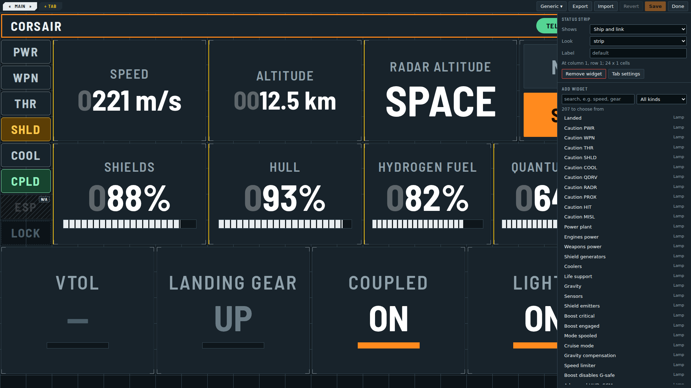
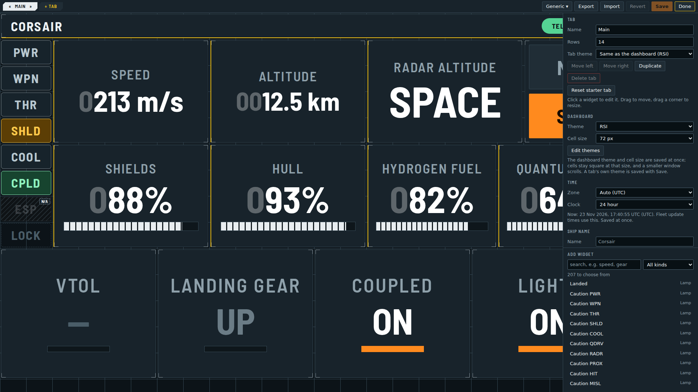
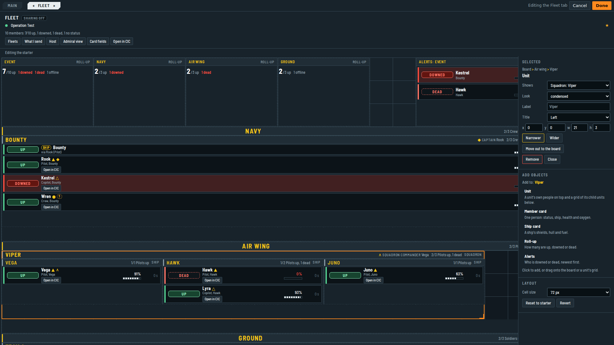

# pages

The web pages the service serves on `127.0.0.1`, embedded into the binaries at build time (by
[`sc-service`](../crates/sc-service/README.md); a change here needs a rebuild). The desktop app
([`sc-app`](../crates/sc-app/README.md)) shows the same pages in native windows.

| File | What |
|---|---|
| `dash.html` | The dashboard: tabs of widgets on a grid, the editor, themes, detached tabs and the fleet panel |
| `unit-grid.js` | The Fleet tab's layout rules (nested unit grids), copied from cic-panel's `crates/cic-relay/static/unit-grid.js` with a header naming the commit; `tools/check-unit-grid.sh` checks the copy |
| `portal.html` | The portal: the ship status and the catalog of functions |
| `vendor/gridstack/` | gridstack 14.1.0, the grid library the dashboard uses |
| `vendor/barlow-semi-condensed/` | The Barlow Semi Condensed font (SIL Open Font License 1.1) |

The editor: select a widget to change it, add widgets from the palette on the right.

With no widget selected, the pane holds the settings: the tab's name, rows and theme, the
dashboard's theme and cell size, and the time zone and clock.

The Fleet tab has its own Edit: select a unit, then add objects into its grid from the palette.

Each page is one self-contained HTML file; the service puts in the per-launch token and the
built-in theme colours when it serves it. The pages talk only to the service, over the portal
WebSocket ([`PROTOCOL.md`](../PROTOCOL.md) section 2), never to the game.

Vendored files are copied unchanged from their npm packages. Each folder's `VERSION` file names
the package version and the SHA-256 of every file, and its `LICENSE` is the upstream licence.
