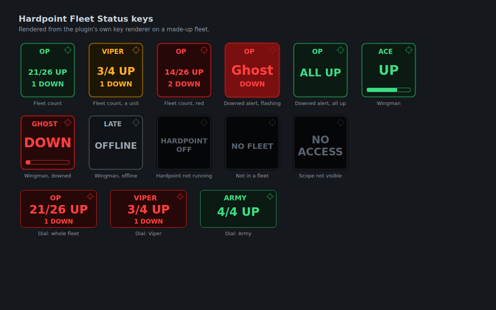

# Hardpoint Fleet Status (Stream Deck plugin)

Hardpoint Fleet Status puts the state of your fleet on Stream Deck keys. It is status only: four
read-only keys, no controls, no sound and no game input. It talks only to Hardpoint, over the
local bus on `127.0.0.1` with Hardpoint's per-launch token. It never talks to a fleet server or to
other players, and it holds no credentials. It is separate from the Stream Deck plugin that keeps
keybinds; both can be installed side by side.

- Name: Hardpoint Fleet Status
- UUID: `games.spyincognito.hardpoint.fleet`
- Needs: Windows 10 or later, Stream Deck 7.1 or later, and Hardpoint running on the same PC.

## Keys



| Key | Shows | Press | Settings |
|---|---|---|---|
| Fleet count | How many are up in a scope, e.g. "21/26 UP", with "N DOWN" under it when anyone is down. Green, amber or red by your thresholds | Asks Hardpoint for the status now; the key shows a tick | Scope: the whole fleet, a unit or one of your groups. Amber below (default 80%), red below (default 60%) |
| Downed alert | "ALL UP" while nobody in scope is down. When someone goes down it flashes red with their handle, or "N DOWN" if several are | Acknowledges the alert and stops the flash; the key stays red while anyone is down. A new downing flashes again | Scope. Count DEAD as well as DOWNED (default on) |
| Wingman | One member: UP, DOWN, DEAD or OFFLINE, and a health bar when they share health | Nothing | Member, picked from the members Hardpoint shows you. Kept by their fleet key, so a new handle does not break it |
| Group roll-up dial (Stream Deck +) | A scope's counts on the dial screen, e.g. "VIPER 3/4 UP 1 DOWN" | Turn: next or previous scope. Press or tap: back to the whole fleet | Which scopes to step through (none chosen: all you can see) |

A key with nothing to report goes dark and never shows old numbers:

- **HARDPOINT OFF**: Hardpoint is not running, or the plugin cannot reach its bus.
- **NO FLEET**: Hardpoint is running but not connected to a fleet.
- **NO ACCESS**: your role does not cover that scope, or that member is not visible to you.

## How it gets data

The plugin reads Hardpoint's bus file (`%APPDATA%\sc-key-emulator\bus.json`, or the file named by
`SC_CONTROL_BUS_FILE`), connects to the local bus with its token, and says `fleet.status` in its
hello. Hardpoint then pushes the fleet status whenever it changes, filtered by your role exactly as
your own fleet panel is. The contract is [`PROTOCOL.md`](../PROTOCOL.md) section 1, Fleet status.

The plugin sends only the hello and the `fleet.status` call; Hardpoint answers no other call from a
`fleet.status` client. It cannot change the game, the fleet or Hardpoint. Acknowledging an alert
is local to the key. If Hardpoint stops, the plugin tries again every 2 seconds.

## Install on Windows

1. Install Stream Deck 7.1 or later from Elgato.
2. Double-click `games.spyincognito.hardpoint.fleet.streamDeckPlugin`. Stream Deck asks to install
   it; accept.
3. In Stream Deck, open the "Hardpoint Fleet Status" category and drag keys onto your deck. Pick
   each key's scope or member in its settings panel below the deck.
4. Start Hardpoint and join a fleet. The keys light up; until then they read HARDPOINT OFF or
   NO FLEET.

Nothing needs network access: the plugin and Hardpoint talk on `127.0.0.1` on the same PC. To
remove the plugin, open Stream Deck's Preferences, then Plugins, select it and uninstall it.

## Build

Node 22.18 or later.

```sh
npm ci
npm test            # node --test on the TypeScript sources
npm run typecheck   # tsc, no output files
npm run build       # bundles to the .sdPlugin folder with esbuild
npm run pack        # build, then streamdeck pack into dist/
```

`npm run pack` writes `dist/games.spyincognito.hardpoint.fleet.streamDeckPlugin`. The build also
draws the plugin icon (the manifest requires PNG there; every other image is SVG) and writes the
runtime dependencies' licences to `bin/THIRD_PARTY_LICENSES.txt`.

## Layout

| Path | What |
|---|---|
| `src/protocol.ts` | The bus messages and the fleet status types |
| `src/busfile.ts`, `src/client.ts` | Finding the bus and the read-only bus client |
| `src/views.ts` | What each key shows, from the status and its settings |
| `src/render.ts` | Key and dial images as SVG |
| `src/actions.ts`, `src/plugin.ts` | The Stream Deck actions and the entry point |
| `games.spyincognito.hardpoint.fleet.sdPlugin/` | Manifest, images, dial layout and settings panels |
| `test/` | Tests, including a fake bus |

## Licence

Copyright 2026 Spy Incognito Games. Apache License 2.0, as the rest of this repo (see the root
`LICENSE` and `NOTICE`). The packaged plugin bundles the Elgato Stream Deck SDK and `ws`, both MIT.
